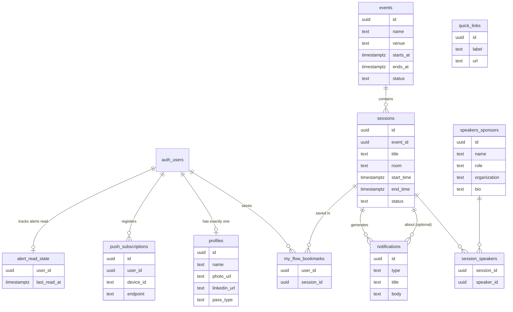

# Sync — The Complete App Guide

> A beginner-friendly walkthrough of everything Sync does, how it works visually, and what every part of the codebase is doing under the hood.

**Written for:** you, the owner of this codebase, treated as a beginner software engineer.
**Read alongside:** `project-overview.md`, `architecture.md`, `ui-context.md` (the formal docs). This guide is the informal teacher.

---

## Table of Contents

1. [What is Sync?](#1-what-is-sync)
2. [The Attendee Journey (screen by screen)](#2-the-attendee-journey)
3. [The Tech Stack, Explained Simply](#3-the-tech-stack)
4. [Tour of the Codebase](#4-tour-of-the-codebase)
5. [How Each Feature Works](#5-how-each-feature-works)
   - 5.1 [Landing Page](#51-landing-page--the-poster)
   - 5.2 [Google Sign-In](#52-google-sign-in--oauth-explained-like-a-story)
   - 5.3 [Profile and Networking Setup](#53-profile-and-networking-setup)
   - 5.4 [Home Dashboard](#54-home-dashboard--the-happening-now-machine)
   - 5.5 [Live Updates (Realtime)](#55-live-updates--realtime)
   - 5.6 [My Flow Bookmarks](#56-my-flow-bookmarks--optimistic-ui)
   - 5.7 [Push Notifications](#57-push-notifications--the-full-pipeline)
   - 5.8 [Alerts Feed](#58-alerts-feed)
   - 5.9 [Connect Page (QR)](#59-connect-page--the-qr-networking-card)
   - 5.10 [Photo Booth](#510-photo-booth--three-shot-story-strip)
    - 5.11 [More Page (Directory)](#511-more-page--directory-and-quick-links)
    - 5.12 [Account Settings](#512-account-settings)
    - 5.13 [Admin Raffle Export](#513-admin-raffle-export)
6. [The Database in Plain English](#6-the-database-in-plain-english)
7. [The Security Model (RLS)](#7-the-security-model--row-level-security)
8. [The Automation (pg_cron)](#8-the-automation--the-minute-job-that-runs-the-event)
9. [Glossary](#9-glossary)
10. ["How Do I…?" Cheat-Sheet](#10-how-do-i--cheat-sheet)

---

## 1. What is Sync?

**Sync** is a companion web app for **AWS Student Community Day Mega Manila 2026** — a one-day event (Sep 11, 2026, 9:30 AM–6:00 PM, Asia Pacific College) where students learn about cloud computing.

Attendees install Sync on their phone like a native app. During the event it answers four questions instantly:

- **What's happening right now?** → the Home dashboard
- **What changed?** → push notifications + the Alerts feed
- **Who is this person I just met?** → the Connect QR card
- **Who's speaking today?** → the More directory

It is **not** a social network or ticketing system. General directory content still lives directly in Supabase, while the narrow allowlisted `/admin` control room handles event-day alerts, schedule corrections, delivery monitoring, attendee lookup, and mutation auditing. Operators use the protected composer for announcements rather than inserting them directly.

The name of the game remains automation-first for program state: session statuses derive from schedule timestamps, while attendee notifications are created only by audited organizer actions. Published sessions are visible to attendees; unpublished drafts stay in the admin workspace and are ignored by schedule automation. When the real event drifts, an admin Start or End override remains authoritative until Resume Auto, and approved operators can send immediate audited alerts from the app.

---

## 2. The Attendee Journey

Here is what a real attendee experiences, from start to finish:

```
1. Opens the link            → Landing page (ceremonial poster)
2. Taps "Sign in with Google" → Google asks permission → back in the app
3. Lands on Home             → Countdown or "Happening Now" card + published schedule
4. Taps a session            → Modal with description, room, speaker, bookmark button
5. Bookmarks sessions        → "My Flow" — their personal schedule; finished sessions leave the flow automatically
6. Gets an alert             → organizers send audited announcements or deliberate manual status updates
7. Meets someone             → Opens Connect, shows the stable multi-social QR card
8. Curious about a speaker   → More, taps a face, reads their bio
9. End of day                → "That's a wrap" card; Alerts retains the recipient's feed
```

**Visually**, the landing page gets the full ceremonial treatment. Everything after sign-in uses the fixed dark AWS SCD local component system: tonal deep-teal panels, warm off-white text, selective gold emphasis, semantic green/yellow/ember states, and one luminous atmospheric Home hero. The event theme is centered at the top of every hero state and is not repeated below the program date.

**On desktop** (≥1024px), the bottom tab bar is replaced by a left sidebar ("rail"), and Home splits into two panes: the Happening Now card pins on the left while the schedule scrolls on the right.

---

## 3. The Tech Stack

| Technology | What it is (plain words) | What it does in Sync |
|---|---|---|
| **Next.js 16** | A React framework that runs code both in the browser and on a server | Renders every page; decides what's public vs private |
| **React 19** | A library for building UI from components | All buttons, cards, modals, forms |
| **Tailwind CSS v4** | Write styles as short class names (`bg-bg-base`) instead of CSS files | The entire look — colors come from brand tokens |
| **Supabase Postgres** | A real PostgreSQL database with a friendly API | Stores everything: profiles, sessions, bookmarks… |
| **Supabase Auth** | Login-as-a-service | The Google sign-in and session cookies |
| **Supabase Realtime** | A websocket service that yells "the database changed!" | Live schedule updates and the live Alerts feed |
| **Supabase Edge Functions** | Small server programs that run on-demand | Sends push notifications |
| **pg_cron** | A database alarm clock (SQL job scheduler) | Flips session statuses every minute, automatically |
| **pg_net** | Lets the database make HTTP requests | Wakes up the push Edge Function |
| **Web Push + FCM** | The browser/phone notification system | Delivers notifications when the app is closed |
| **Vercel** (planned) | Hosting for Next.js apps | Will serve the app in production |

**Key idea:** there is no traditional "backend server" you wrote. The Next.js server components + Supabase + database triggers *are* the backend. This style is common now and it's why the codebase is small.

---

## 4. Tour of the Codebase

```
sync/
├── app/                      ← Every screen lives here (Next.js routing)
│   ├── page.tsx              ← Landing page ("/")
│   ├── login/                ← Sign-in page (now a shim to "/")
│   ├── auth/callback/        ← OAuth return stop
│   ├── (admin)/               ← Protected operations workspace
│   └── (app)/                ← Route group: pages WITH the nav rail/tabs
│       ├── layout.tsx        ← Sidebar + tab bar wrap every page below
│       ├── home/             ← Dashboard (+ actions.ts = server actions)
│       ├── alerts/           ← Notifications feed + session modal access
│       ├── connect/          ← QR networking card
│       ├── more/             ← Quick links + directory
│       └── settings/         ← Account editing, linked from header/rail (+ actions.ts)
├── components/               ← Reusable UI pieces
│   ├── home/                 ← Hero card, session cards, dashboard shell
│   ├── alerts/               ← Alerts feed client
│   ├── sessions/             ← Shared session modal used by Home + Alerts
│   ├── connect/              ← The QR networking card
│   ├── more/                 ← Directory + bio modal
│   ├── push/                 ← Permission gate, install chip, SW registration
│   ├── settings/             ← Profile edit form
│   ├── bottom-tabs.tsx       ← Mobile bottom nav
│   ├── side-rail.tsx         ← Desktop left nav
│   └── status-badge.tsx      ← Not Started / Ongoing / Finished badge
├── hooks/                    ← React hooks (reusable behavior)
│   └── use-realtime-refetch.ts ← Subscribes to DB changes, refetches
├── lib/                      ← Non-UI logic
│   ├── supabase/             ← Clients (browser + server), types, queries
│   ├── format.ts             ← Manila-time + relative-time formatters
│   ├── social.ts             ← Social URL validation + normalization
│   └── push.ts               ← Browser push subscription helpers
├── proxy.ts                  ← Traffic cop: refreshes sessions, gates private routes
├── public/                   ← Static files: sw.js (service worker), icons, manifest
├── supabase/
│   ├── migrations/           ← Versioned SQL that shaped the database
│   └── functions/send-push/  ← Edge Function that sends pushes
├── scripts/generate-icons.mjs ← Regenerates the PWA icons
└── docs/                     ← You are here
```

**The three most important ideas in the folder layout:**

1. **`app/` = URLs.** A folder named `alerts` inside `app/(app)/` becomes the `/alerts` page. Special files: `page.tsx` (the screen), `layout.tsx` (wrapping chrome), `route.ts` (a plain API endpoint), `actions.ts` (server functions the UI can call).
2. **`components/` = reusable pieces.** If two screens need the same modal or badge, it lives here, not copied twice.
3. **`lib/` and `hooks/` = brains without UI.** Database queries, date formatting, validation — logic that both server and browser can share.

---

## 5. How Each Feature Works

Each section follows the same pattern: **what you see → what happens under the hood → the files involved.**

---

### 5.1 Landing Page — "The Poster"

**What you see:** a portrait teal story-sky with restrained comet motion, the word **SYNC** with a light-band sweeping across it, and a yellow "Sign in with Google" button.

**Under the hood:** there's no video and no image files. Everything is **pure CSS and one inline SVG**:

- The sky = `public/assets/story-sky.webp`, layered with a restrained readability treatment and grain.
- Comet = one thin gradient line with `animation: comet-fall …` that translates diagonally across the screen. Six comets exist, each with its own start position, speed, and delay — the delays are **negative**, meaning the shower is already mid-flight the instant the page loads.
- The sheen on SYNC = the text is actually transparent; a moving gradient shows *through* the letters using `background-clip: text`.
- Accessibility: everything animated is switched off for people whose OS requests `prefers-reduced-motion`, and the comets fall back to static faint streaks.

**Files:** `app/page.tsx` (markup), `app/globals.css` (portal artwork and animation keyframes), `public/assets/story-sky.webp`, `app/layout.tsx` (loads Geist + Perandory).

**One lesson baked in:** OAuth starts in the browser Supabase client so the PKCE verifier is written in the same browser or installed-app context that returns from Google. The button disables immediately to prevent duplicate flows.

---

### 5.2 Google Sign-In — OAuth Explained Like a Story

**What you see:** tap the button → Google's page asks you to sign in and approve → you're back in the app, already signed in with your Google name and photo.

**The story of what actually happened:**

```
You (browser)                Our server/Supabase            Google
     │  1. tap button               │                          │
     │ ──signInWithOAuth()─────────▶│                          │
     │                              │ 2. build authorize URL   │
      │ ◀── redirect to Google ──────│─────────────────────────▶│
     │  3. consent screen           │                          │
     │ ────────────── you approve ────────────────────────────▶│
      │                              │ 4. Google calls back     │
     │                              │◀── with a one-time code ─│
     │  5. redirect to /auth/callback?code=…                   │
     │ ── exchange code ────────────▶│                          │
     │ ◀── session cookies set ──────│  + profile row created   │
```

1. **Tap.** The browser client calls `supabase.auth.signInWithOAuth({ provider: "google" })`. Supabase stores the PKCE verifier in the browser's SSR cookie storage and generates a Google URL that embeds *where you want to end up* (`/auth/callback`).
2. **Consent.** Google authenticates you and returns the standard identity claims we need for name, email, and photo.
3. **Callback to Supabase.** Google hands a one-time code to `https://…supabase.co/auth/v1/callback`, which exchanges it for an application session.
4. **Supabase creates your account** — an `auth.users` row with your name/photo — and a **database trigger** (`handle_new_user`, see §6) instantly creates your matching `profiles` row.
5. **Back to the app.** Supabase redirects your browser to `/auth/callback?code=…`; the route handler exchanges the code using the browser-shared verifier cookie and refreshes the profile photo when Google provides one. Duplicate callbacks recover to the established session instead of displaying a PKCE storage error. An app-shaped `/auth/complete` handoff starts one clean hard-document navigation during HTML parsing, with a client-side fallback, so Android browsers cannot retain Google's wide viewport scale and users do not wait for the handoff component to hydrate.

**The code that decides where you land** (`app/auth/callback/route.ts`):

```ts
const destination = getSafeInternalPath(searchParams.get("next"));
```

**War story #1 — the redirect loop.** Early on, sign-ins kept failing with the browser landing on `/login?code=…` going in circles. Two causes, both fixed and worth remembering:

- Supabase only honors a redirect target if it's **allowlisted** in the dashboard (Authentication → URL Configuration). Anything else silently falls back to the Site URL.
- Our own `proxy.ts` was intercepting `/auth/callback` and bouncing signed-out users — with the OAuth `code` still in the URL — into a loop with the login page. Lesson: **OAuth callbacks must be reachable while signed out**, and proxies should strip query params when redirecting.

As a safety net, the landing page still detects a stray `?code=` and forwards it to `/auth/callback` so sign-in completes even if configuration drifts again.

**Files:** `components/auth/sign-in-button.tsx` (start of flow), `app/auth/callback/route.ts` (code exchange), `app/auth/complete/page.tsx` (clean document handoff), `proxy.ts` (session refresh + gating), `app/login/page.tsx` (self-heal shim).

---

### 5.3 Profile and Networking Setup

**What you see:** after sign-in, Home is available immediately. Account Settings lets an attendee edit their display name and optionally save LinkedIn, Instagram, Facebook, or GitHub links.

**Why it exists:** Google supplies the identity name and photo, while social links are optional attendee-owned enrichment. Connect always has a stable QR target; saving at least one approved social link activates the card.

**Under the hood, three layers of defense:**

1. **Route guard** — `requireCompleteProfile()` (in `lib/supabase/profile.ts`) ensures an authenticated profile exists before private pages render. Missing social links are not a reason to redirect.
2. **Client validation** — `lib/social.ts` validates approved networks and normalizes supported profile and share URL variants.
3. **Server + database validation** — the server action re-validates the complete link set before saving, and database constraints remain a final backstop.

The QR encodes the app-owned `/c/<public_token>` card URL, not a mutable external profile URL. The stable card can activate retroactively when links are later saved.

**Files:** `app/(app)/settings/`, `lib/social.ts`, `lib/supabase/queries/networking.ts`, `lib/supabase/profile.ts`.

---

### 5.4 Home Dashboard — The "Happening Now" Machine

**What you see (mobile):** your clean header and profile menu, the hero card, a segmented **All | My Flow** toggle, and stacked published-session cards with time, title, room, status badge, and a bookmark icon. On desktop the hero pins on the left while the list scrolls on the right.

**The hero card's four brains** (`components/home/hero-card.tsx`). It re-renders every second with the device clock and picks a state:

```ts
const startsAt = new Date(event.starts_at).getTime();
const endsAt   = new Date(event.ends_at).getTime();

if (now >= endsAt) → "That's a wrap" card

const current = sessions.find(s => now >= s.start && now < s.end);
if (current)  → "Happening Now" + title + room (accent treatment)

const next = sessions.find(s => s.start > now);
if (next && now >= startsAt) → "Up Next" preview card

otherwise → "Starts In" countdown (D/H/M/S boxes)
```

**The key insight:** status is **computed from timestamps, not stored in the UI**. The database *also* stores a `status` column (the cron job keeps it fresh — §8), but the screen doesn't trust it for display; it trusts math. That means the UI can never show a stale badge, even if the cron is a few seconds late.

**The status badge component** (`components/status-badge.tsx`) maps the computed status to fixed colors — the same mapping everywhere in the app, per the code standards:

| Status | Look |
|---|---|
| Not Started | yellow-green outline |
| Ongoing | light-green fill + soft pulsing glow |
| Finished | dimmed text |

The Home server query and every Realtime refetch explicitly add `published = true`. This is necessary even for an administrator signed into the attendee view because the database lets admins read drafts for the operations workspace. A linked alert uses the same published-only lookup; if a session was later unpublished, the alert says its details are unavailable.

The admin session editor labels its `datetime-local` fields **(PHT)**. Those values are parsed as Asia/Manila wall-clock time and converted to an explicit UTC instant before the database RPC runs, so the browser timezone and server timezone cannot change the scheduled hour.

**Files:** `app/(app)/home/page.tsx` (server: fetches everything once), `components/home/home-client.tsx` (client: owns the data state), `components/home/hero-card.tsx`, `components/home/session-card.tsx`, `components/sessions/session-modal.tsx`, `components/admin/session-editor.tsx`, `lib/format.ts` (Manila-time formatting and input conversion).

---

### 5.5 Live Updates — Realtime

**What you see:** with the app open, an organizer edits a session (say, changes the room) — and your screen updates by itself. No refresh.

**Under the hood, in three acts:**

**Act 1 — the database shouts.** Supabase Realtime watches specific tables. We told it which ones:

```sql
-- supabase/migrations/20260822132000_enable_realtime.sql
alter publication supabase_realtime add table public.sessions;
alter publication supabase_realtime add table public.my_flow_bookmarks;
alter publication supabase_realtime add table public.events;
```

A "publication" is Postgres's way of saying *"broadcast changes to these tables."*

**Act 2 — the browser listens.** A reusable hook opens one channel and reacts to any change by refetching fresh data:

```ts
// hooks/use-realtime-refetch.ts (simplified)
const supabase = createClient();

// CRITICAL: recover the session BEFORE joining the channel.
await supabase.auth.getSession();

channel = supabase.channel("realtime:" + tableKey);
for (const table of tables) {
  channel = channel.on("postgres_changes",
    { event: "*", schema: "public", table }, scheduleRefetch);
}
channel.subscribe();
```

Any event triggers a **debounced refetch** (at most one refetch per 250ms even if ten changes land at once), and the fresh data replaces the component's state.

**War story #2 — the invisible bug.** The first version subscribed *without* waiting for the session to recover. The websocket joined as "anonymous," and since every table's RLS says "authenticated users only," Realtime silently filtered out **every payload** — no errors, no data. The lesson: **authorize the socket before subscribing**, always. (This also required adding `notifications` to the publication later — a table created after the original migration is *not* automatically broadcast.)

**Files:** `hooks/use-realtime-refetch.ts`, `hooks/use-program-flow-realtime.ts` (thin wrapper listing Home's tables), `components/home/home-client.tsx` (owns the live state), `components/alerts/alerts-client.tsx` (same pattern for the feed).

---

### 5.6 My Flow Bookmarks — Optimistic UI

**What you see:** tap the bookmark icon on an upcoming or ongoing session card → it fills gold instantly. Toggle **My Flow** and only your saved, unfinished sessions show. Finished sessions have no bookmark action and leave My Flow automatically.

**"Optimistic UI"** means the screen updates *before* the server confirms. The pattern (`components/home/home-client.tsx`):

```ts
function handleToggleBookmark(sessionId: string) {
  // 1. Update the screen immediately (pretend it worked)
  setBookmarks(previous => {
    const next = new Set(previous);
    next.has(sessionId) ? next.delete(sessionId) : next.add(sessionId);
    return next;
  });

  // 2. Now actually tell the server
  startTransition(async () => {
    const result = await toggleBookmark(sessionId);
    if (result.error) {
      // 3. Server said no → undo the pretend change
      setBookmarks(/* flip it back */);
    }
  });
}
```

The server action (`app/(app)/home/actions.ts`) checks who you are and rejects new bookmarks for finished sessions, then inserts or deletes **your own** row in `my_flow_bookmarks` — the database's RLS (§7) would reject anything else even if the code tried. The scheduled status job removes finished-session bookmark rows independently of notification delivery.

---

### 5.7 Push Notifications — The Full Pipeline

**What you see:** your phone buzzes when an organizer sends an announcement or deliberately confirms a manual status update. The app wasn't even open.

This is the most connected feature in the app — five systems passing a baton:

```
  ┌──────────┐  1. status sync     ┌───────────────┐  2. organizer row ┌───────────────┐
 │ pg_cron  │ ──────────────────▶ │ sessions      │ ───────────────▶ │ notifications │
  │ (minute) │  status/cleanup     │ status/time   │  organizer only │    table      │
 └──────────┘                     └───────────────┘                  └───────┬───────┘
                                                                      3. pg_net webhook
                                                                      POST /functions/v1/
                                                                             send-push
                                                                             │
                                                            4. Edge Function ▼
                                                            ┌─────────────────────────┐
                                                            │ check secret header     │
                                                            │ choose push recipients  │
                                                            │ web-push → FCM/APNs     │
                                                            │ prune dead endpoints    │
                                                            └───────────┬─────────────┘
                                                              5. push   │
                                                                ┌───────▼───────┐
                                                                │ Your phone 📱 │
                                                                └───────────────┘
```

**Hop by hop:**

1. **pg_cron** (§8) flips only non-overridden sessions and performs finished-bookmark cleanup. Admin Start/End actions use the transactional notification path only when the operator confirms a send.
2. Every notification snapshots its recipients. Organizer alerts snapshot everyone or explicit attendee IDs. Only those recipients can read the row in Alerts; historical automatic rows remain immutable history.
3. An AFTER-INSERT trigger creates a durable dispatch and calls `send-push` with only the notification ID and a shared secret.
4. The Edge Function claims that dispatch once, loads canonical recipients/subscriptions, sends in bounded batches, records accepted/failed/pruned device outcomes, counts recipients without push, and prunes 404/410 endpoints.
5. The service worker displays the push and opens `/alerts`. Admin “accepted” results mean the push service accepted the message, not that the device visibly displayed it.

### Notification audience matrix

| Scenario | In-app Alerts | Push target |
|---|---|---|
| Scheduled status transition | No new notification | None |
| Manual Start or End with **Notify every attendee** checked | Snapshotted profiles for everyone | Every available device for those profiles |
| Manual Start or End with notification unchecked | No new notification | None |
| Resume Auto | No new notification | None |
| Admin announcement to Everyone | Snapshotted profiles for everyone | Every available device for those profiles |
| Admin announcement to Selected | Snapshotted selected profiles only | Every available device for those profiles |

The snapshot is immutable: users who subscribe or are selected after the send do not receive that earlier alert. A recipient without a push subscription still sees the in-app Alerts row. A recipient with multiple devices is targeted on each stored device. Failed or expired endpoints are recorded and stale 404/410 endpoints are pruned. The delivery count shown to admins means accepted by the push service, not confirmed display on a phone.

**How your device subscribed in the first place:** the home screen shows the *"Get session alerts"* explainer. Granting permission triggers `pushManager.subscribe()` with our **VAPID public key** (a key pair that proves to push services that *we* are allowed to send), and the subscription (endpoint URL + encryption keys) is stored in `push_subscriptions` via a server action.

**War story #3 — the silent 403.** The first live test produced no notification and no error. The debug trail (a temporary service-role-only RPC exposing pg_net's HTTP log) showed our own function answering **403 Forbidden**: the database trigger signed requests with a secret from the database, while the function compared against a *different* secret set earlier via CLI. Two generators, zero overlap. Fix: the function's secret is now always synced from the DB's `private.app_secrets`. Lesson: **a shared secret must have exactly one source of truth.**

**Files:** `supabase/migrations/20260822140000_notifications_and_push.sql`, `supabase/migrations/20260822160000_smart_notifications.sql`, `supabase/functions/send-push/index.ts`, `public/sw.js`, `lib/push.ts`, `components/push/push-gate.tsx`, `app/(app)/home/actions.ts` (`savePushSubscription`).

---

### 5.8 Alerts Feed

**What you see:** the **Alerts** tab — a compact reverse-chronological activity feed. Semantic icons and readable labels distinguish live, reminder, announcement, and wrapped updates. Timestamps read like "2 minutes ago." The navigation icon shows a persisted unread count and opening Alerts marks the current feed as read.

**Under the hood:** one recipient-filtered query, newest-first, limited to 50; RLS requires a matching immutable `notification_recipients` row. Realtime makes new permitted alerts appear without refreshing. Session-linked cards open the shared modal only while the session is published; otherwise the card reports **Session details unavailable**. Announcements remain static. `alert_read_state` uses database time so device-clock skew cannot incorrectly mark future alerts as read.

**Files:** `app/(app)/alerts/page.tsx`, `components/alerts/alerts-client.tsx`, `components/alerts-count-provider.tsx`, `components/sessions/session-modal.tsx`, `lib/supabase/queries/notifications.ts`, `lib/supabase/queries/alert-reads.ts`.

---

### 5.9 Connect Page — The QR Networking Card

**What you see:** a stable QR tile, Save QR, a live preview of your selected social card, the card-template picker, and the list of configured social profiles.

**Under the hood:**

- The QR encodes the app-owned `/c/<public_token>` URL. The token stays stable while the attendee changes their social links.
- The inline preview and public route share the same selected `NetworkCard` template, so choosing a template updates the visible card immediately.
- **Save QR** works via a hidden `qrcode.react` canvas (`QRCodeCanvas`, 512px): clicking grabs `canvas.toDataURL("image/png")` and triggers a download.
- The public card reveals the attendee's Google identity plus only their saved social destinations. Save QR stays disabled until a link is added. Only a verified owner preview gets Back to Connect.

**Files:** `app/(app)/connect/page.tsx`, `components/connect/connect-card.tsx`, `next.config.ts`.

---

### 5.10 Photo Booth — Three-Shot Story Strip

**What you see:** open **Photo Booth** from More, choose one of the two event-frame buttons, take three photos with three-second countdowns, then download one event-framed vertical story strip. You can switch between front and rear cameras when the device makes both available, choose an existing image for any slot, and retake one slot without losing the other two. During review, changing the frame reuses the same photos and rebuilds the strip without another capture.

**Under the hood:** the browser asks for camera permission only after the attendee chooses **Open camera**. Each source image stays in browser memory as a temporary object URL. Once all three slots are full, a canvas draws the selected static frame and three centre-cropped landscape photos into a high-quality 1080×1920 JPEG. Both frames use the same narrower illustrated-window geometry with dark-teal outlines, then redraw foreground mascots above photos; Frame 1 also draws its small `09.11.26` date beneath the existing event title. Neither source images nor the finished JPEG are uploaded, stored in Supabase, or attached to an account. Camera tracks stop whenever review starts, the page is hidden, or the component unmounts.

**Files:** `app/(app)/more/photo-booth/page.tsx`, `components/photo-booth/photo-booth-client.tsx`, `scripts/generate-photo-booth-frame-2-overlays.mjs`, `public/assets/event-frame-source.png`, `public/assets/event-frame-source-2.png`, `public/assets/event-frame-2-background.png`, `public/assets/event-frame-2-mascot-fox.png`, `public/assets/event-frame-2-mascot-crystal.png`, `public/assets/event-frame-2-top-overlay.png`, `public/assets/event-frame-2-left-overlay.png`, `public/assets/event-frame-2-title-overlay.png`, `public/assets/event-frame-2-date-overlay.png`, `public/assets/event-frame-1-date-overlay.png`.

**Access:** the Photo Booth is available to authenticated attendees from More. Camera frames, selected images, and the finished JPEG remain local to the browser and are never uploaded or persisted.

---

### 5.11 More Page — Directory and Quick Links

**What you see:** two stacked sections — **Quick Links** (an external event-website card and an in-app Photo Booth card) and **Speakers**: an image-led responsive lineup that uses a branded initial when no portrait is supplied. Tap a speaker → their **bio modal** (role, portrait or initial, optional organization, bio, and LinkedIn button). Account Settings is reached from the shared mobile header or desktop navigation rail, not from the More page body.

**Under the hood:**

- The route passes every read-only directory record with the `speaker` role to the lineup. New speaker records can appear before their optional portrait, organization, bio, LinkedIn URL, or session links are supplied.
- The bio modal is the same visual language as the session modal: a focused, tonal, blurred-backdrop overlay using gold only for primary external actions.
- Quick links come from the `quick_links` table. Root-relative destinations stay inside the PWA through `next/link`; external destinations open separately.

**Files:** `app/(app)/more/page.tsx`, `components/more/directory-client.tsx`, `lib/supabase/queries/directory.ts`, `…/quick-links.ts`.

---

### 5.12 Account Settings

**What you see:** a form with your name and optional social links prefilled. Save → "Profile saved." and every screen reflects the change.

**Under the hood:** the `updateProfile` server action validates the name and complete social-link set through the shared normalizers, updates **your own** profile rows, then calls `revalidatePath()` on `/home`, `/connect`, `/settings`, `/more` so Next.js re-renders any cached page that shows your data. The page also shows current-device push status: enabling requests permission and stores the browser subscription, while disabling unsubscribes the browser and removes its own subscription row. Unsupported or denied browsers show guidance instead of an actionable toggle. A shared history-aware Back button returns through in-app history and falls back to `/home`.

**Files:** `app/(app)/settings/page.tsx`, `app/(app)/settings/actions.ts`, `components/settings/settings-form.tsx`, `components/settings/notification-settings.tsx`, `components/settings/settings-back-button.tsx`, `app/(app)/home/actions.ts`.

---

### 5.13 Admin Raffle Export

**What an operator sees:** the protected Attendees page has an **Export raffle names** action. It opens a fresh preview containing one eligible attendee per line, ready to paste into Wheel of Names or download as a plain-text file.

**Duplicate names:** distinct profiles keep distinct raffle chances. Names that match after case and whitespace normalization receive stable labels such as `Juan Dela Cruz #1` and `Juan Dela Cruz #2`. Those labels are clickable only inside the protected preview, where they open the existing attendee detail dialog to confirm the correct person. The copied/downloaded list contains labels only, never internal IDs.

**Eligibility and privacy:** every non-admin profile with a usable name gets one entry; profiles with blank names are skipped and counted. Sync fetches this snapshot only when an admin opens the export workflow. The preview, copied text, and downloaded file contain displayed labels only, never internal IDs. The export is a read-only operation and does not persist or audit the snapshot.

**Files:** `app/(admin)/admin/attendees/page.tsx`, `components/admin/attendee-directory.tsx`, `lib/raffle.ts`, `lib/supabase/queries/admin.ts`, `supabase/migrations/20260909125851_raffle_attendee_export.sql`.

---

## 6. The Database in Plain English

Ten public tables. Here's each one's job and how they hold hands:



**Table-by-table, in one breath each:**

| Table | Job | Who writes it |
|---|---|---|
| `profiles` | Your identity: name, photo, canonical LinkedIn URL; pass type remains dormant | Created by a trigger on signup; **you** edit supported fields in Settings |
| `events` | The event itself — one row: name, venue, time span, status | Organizers via SQL; status auto-flips |
| `sessions` | Every slot plus effective status, manual override, and actual action timestamps | Schedule automation or audited admin Start/End/Resume Auto |
| `speakers_sponsors` | People: name, photo, role (speaker/host/panelist/sponsor), org, bio, LinkedIn | Organizers via SQL |
| `session_speakers` | Join table: which person appears in which session | Organizers via SQL |
| `my_flow_bookmarks` | Your saved sessions (user_id + session_id) | **You**, via the bookmark button |
| `notifications` | Alert content, source, audience metadata, and dispatch trigger | Audited admin functions; historical schedule rows remain retained |
| `push_subscriptions` | Your device ID, push endpoint, and encryption keys | **You**, when enabling alerts; one device can replace its endpoint without affecting other devices |
| `alert_read_state` | Your latest Alerts-feed read timestamp, used for the unread badge | **You**, when opening Alerts |
| `quick_links` | The More page link cards | Organizers via SQL |

**Why `session_speakers` is its own table:** one speaker can appear in multiple sessions, and one panel has multiple people. A join table expresses "many-to-many" without duplicating anyone.

**Migrations** (`supabase/migrations/*.sql`) are the database's version history — numbered files applied in order. Never edit an applied one; always add a new file. `lib/supabase/database.types.ts` is **generated** from the schema (`npx supabase gen types typescript --linked`) so TypeScript knows every table's shape — never hand-edit it.

---

## 7. The Security Model — Row Level Security

**The problem RLS solves:** your browser talks straight to the database (through Supabase's API) with your credentials. If the database itself doesn't enforce rules, any user could query anyone's data by typing a URL. App-level checks are not enough — the database must be the bouncer.

**How it works:** every table has RLS **enabled**, and **policies** — SQL rules deciding who sees or changes which rows. Ours, in plain English:

```sql
-- Everyone content table: signed-in users read, nobody writes
create policy "Authenticated users can view published sessions"
  on public.sessions for select to authenticated
  using (published or (select private.is_admin()));

-- Personal tables: strictly your own rows
create policy "Users can delete own bookmarks"
  on public.my_flow_bookmarks for delete to authenticated
  using ((select auth.uid()) = user_id);
```

`auth.uid()` is a Supabase function that reads **your identity from your login token (JWT)**. The `(select auth.uid())` wrapping is a performance idiom — it caches the answer once per query instead of evaluating per row.

**The resulting rulebook:**

| You are… | You can… | You cannot… |
|---|---|---|
| Signed out | See the landing page | See *any* data at all |
| Signed in | Read published event content; edit your own profile, bookmarks, push subscriptions, and alert read state | See another user's profile, bookmarks, subscriptions, or alert state; read unpublished drafts outside the admin workspace; write to any content table; delete anything you don't own |

**War story #4 — proof it works.** During testing we deliberately tried to insert a bookmark with someone else's (or no) user ID. The database rejected it with a policy violation — the app code never even got a chance to be wrong. That's RLS doing its job.

**Also worth knowing:** Realtime (§5.5) applies these same policies to its websocket payloads, and the push webhook's trigger runs as a **security definer** function reading a secret from a schema that anonymous users can't even see (`private.app_secrets`).

---

## 8. The Automation — The Minute Job That Runs the Event

The single most important piece of automatic program state is one function on a timer:

```sql
-- supabase/migrations/…130000 (simplified)
create or replace function public.sync_program_flow_statuses()
returns void language plpgsql as $$
begin
  -- For every session whose stored status no longer matches reality…
  for flipped in
    select s.id, s.title, s.room,
           case when now() < s.start_time then 'not_started'
               when now() >= s.end_time  then 'finished'
                else 'ongoing' end as new_status
      from public.sessions s
     where s.status is distinct from (…same case…)
  loop
    -- …flip it…
    update public.sessions set status = flipped.new_status where id = flipped.id;

    -- Finished-session bookmarks are cleaned up independently.
    if flipped.new_status = 'finished' then
      delete from public.my_flow_bookmarks where session_id = flipped.id;
    end if;
  end loop;
  -- No schedule-generated reminder, live, or ended notification is written.
  -- (events.status gets the same treatment)
end; $$;

select cron.schedule('sync-program-flow-statuses', '* * * * *',
  $$select public.sync_program_flow_statuses()$$);
```

Read the `where s.status is distinct from (...)` clause carefully — it's the quiet genius of the design:

- Sessions only get **written** when their status *actually changed* → no pointless database churn, no spam.
- A write is exactly what Realtime (§5.5) and the notification trigger (§5.7) are waiting for → the whole machine advances itself.
- Status can never drift more than ~60 seconds from the truth, because the job runs every minute.

This is why scheduled event-day behavior needs no organizer at the controls for program state: statuses and finished-bookmark cleanup write themselves, while open clients update through Realtime. Operators use the protected admin composer or deliberate manual status confirmation for attendee alerts; direct SQL remains for directory/quick-link maintenance and source-controlled schedule replacements.

---

## 9. Glossary

| Term | Plain-English meaning |
|---|---|
| **RLS (Row Level Security)** | Database rules deciding which rows each user may see/change. The bouncer. |
| **JWT** | Your signed login badge — a token proving who you are, attached to every request. |
| **Server Component** | React code that runs only on the server; can query the database directly, can't have buttons that respond instantly. Default in this app. |
| **Client Component** | React code that also runs in the browser (`"use client"`); needed for countdowns, toggles, modals. |
| **Server Action** | A server function a form/button can call directly (`"use server"`) — no manual API endpoint. |
| **Service Worker** | A background script the browser runs even with the app closed; receives pushes, caches files. |
| **OAuth / OIDC** | The "Sign in with…" dance: you approve on Google, we get a verified identity without ever seeing your password. |
| **PKCE** | The proof-key trick making the OAuth code exchange safe for public apps. |
| **Edge Function** | A small program deployed to Supabase that runs on demand (Deno runtime). |
| **pg_cron** | In-database scheduler — SQL on an alarm clock. |
| **pg_net** | In-database HTTP client — lets SQL call a URL. |
| **Publication (Realtime)** | Postgres's list of tables whose changes get broadcast live. |
| **Optimistic UI** | Update the screen first, confirm with the server second, roll back on failure. |
| **VAPID keys** | A key pair identifying our server to push services — "these pushes are really from Sync." |
| **Canonical data** | One agreed stored form of messy input (approved social URLs are normalized before saving). |
| **Migration** | A numbered SQL file describing a database change; applied in order, never edited after the fact. |
| **Hydration** | The moment server-rendered HTML comes alive in the browser. Mismatches between the two cause bugs. |

---

## 10. "How Do I…?" Cheat-Sheet

**…change the schedule?**
Use the source-controlled finalized-program migration for a complete schedule replacement. The current event has 13 main-program rows plus three parallel workshop rows; statuses, notifications, and pushes adjust automatically. Use the admin session editor for event-day title, room, and time corrections plus status overrides; its date-time fields are always Asia/Manila (PHT). Only unpublished, not-started drafts may be hard-deleted, after confirmation.

**…open seats in a full workshop?**
Open the session in the admin session editor and lower **Registered off-app**. That number is the organiser export's registration count, and the gap between it and **Capacity** is what attendees can take in the app — drop Track A from 33 to 30 and three attendees can each claim a seat, at which point it reads `33/33 · Full` again. **Close seats** presents the session as Full even with seats free, and refuses new claims without touching the seats people already hold. Leave **Capacity** blank for any session that has no seat limit; that is every non-workshop row and shows attendees nothing at all. Capacity can never be set below the seats attendees are already sitting in — the database refuses and the editor says by how much.

**…add a quick link?**
`insert into quick_links (label, url, icon) values ('Label', 'https://…', 'globe');` — `icon` accepts `globe` or `camera` (mapped in `app/(app)/more/page.tsx`).

**…add a speaker?**
Insert into `speakers_sponsors`, then link them to sessions via `session_speakers`. The current Next.js image configuration permits LinkedIn CDN photos (`media.licdn.com`); add another explicit `remotePatterns` host before using a different external image provider.

**…replace the placeholder PWA icons?**
Replace the source artwork in `public/logo.png`, then run `node scripts/generate-icons.mjs`. The generator emits the transparent browser/mascot assets, full-seal PWA icons, padded maskable and Apple icons, and notification icon/badge; do not edit the generated PNGs individually.

**…test push notifications myself?**
Set a session's `start_time`/`end_time` to bracket the current moment, wait up to a minute for cron, and watch. (Your OS must allow notifications for the browser!)

**…add a new private page?**
Create `app/(app)/your-page/page.tsx` — it automatically gets the rail + tab chrome. Add a `requireCompleteProfile()` call at the top if it should be members-only, and an entry in `bottom-tabs.tsx` + `side-rail.tsx`.

**…know if the database changed shape?**
Run `npx supabase gen types typescript --linked --schema public` and commit the refreshed `lib/supabase/database.types.ts`.

**…deploy for production?**
Hosting isn't finalized (Vercel + Supabase Cloud is the assumed pairing). When it happens: add the production domain to Supabase's redirect allowlist **and** Google's OAuth app settings, set the same env vars on the host, and deploy the Edge Function again.

---

*End of guide. When something in the code confuses you, find the feature above, open the named files, and read them next to the explanation — the whole app fits in your head once you've traced one feature end to end.*
